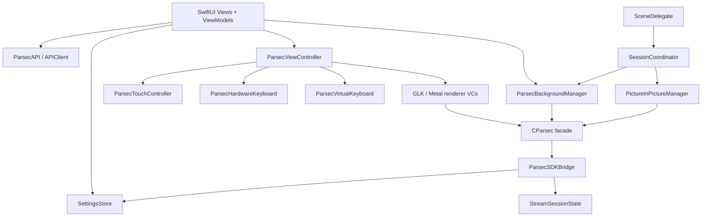

# OpenParsec Refactoring Strategy

> **Status:** Active plan (supersedes the 2024 draft that described the old flat folder layout).
> **Scope:** Refactor for maintainability, testability, and modern Swift patterns **without changing any user-facing behavior**.
> **Constraint:** The app must build and run at the end of every phase.
> **Minimum deployment target:** iOS 17.0 (the project-level target must be raised from 13.0 to 17.0 to match the app target; `armv7` removed from Info.plist; README updated to "iOS 17+").

---

## 1. Executive Summary

OpenParsec is a functional but heavily coupled SwiftUI + UIKit hybrid. The folder reorganization proposed by the previous strategy doc was completed, but the deeper problems it identified remain:

- **`ParsecViewController` is still a god object.** The class itself is 688 lines, but together with its three extension files it forms a ~1,530-line unit ([ParsecViewController.swift](../OpenParsec/ViewControllers/ParsecViewController.swift), [ParsecGestureHandling.swift](../OpenParsec/ViewControllers/ParsecGestureHandling.swift) 569 lines, [ParsecKeyboard.swift](../OpenParsec/ViewControllers/ParsecKeyboard.swift) 257 lines) sharing ~60 mutable state variables. Touch pipeline, momentum, keyboard, and cursor logic are all tangled in one class.
- **Networking is duplicated and callback-based.** The same `URLSession.dataTask` + hardcoded URL + hardcoded User-Agent (`parsec/150-93b Windows/11 libmatoya/4.0`) pattern appears in 4 places ([LoginView.swift:150-233](../OpenParsec/Views/Login/LoginView.swift), [MainViewMethods.swift:54-222](../OpenParsec/Views/Main/MainViewMethods.swift)). There is no `async/await` anywhere.
- **Keychain access is scattered across 3 files** (`ContentView.initApp`, `LoginView.saveToKeychain`, `MainViewMethods.removeFromKeychain`).
- **Global mutable state is everywhere:** `CParsec` (static facade over a force-unwrap `parsecImpl`), `DataManager.model`, `SettingsStore.shared` + a 26-line static proxy `SettingsHandler`, `NetworkHandler.clinfo`, `GLBDataModel.shared`, global `var appScheme`, `ConnectionLog.shared`, `CParsec.drawRate`/`runningRenderer`/`setupError`.
- **Misplaced types:** models defined at the bottom of a view's methods file (`IdentifiableHostInfo`, `Page` in [MainViewMethods.swift:373-388](../OpenParsec/Views/Main/MainViewMethods.swift)), a `View` extension inside [ParsecViewMethods.swift:317-325](../OpenParsec/Views/Stream/ParsecViewMethods.swift), the `RenderLoop` protocol inside [ParsecBackgroundManager.swift:5-9](../OpenParsec/Managers/ParsecBackgroundManager.swift), 4 unrelated types in [ParsecTouchHelpers.swift](../OpenParsec/ViewControllers/ParsecTouchHelpers.swift), and `ParsecResolution`/`MouseInfo`/`RendererType`/`ConnectionLog` living in SDK files.
- **Dead code:** the `.test` case in [ContentView.swift:4-9](../OpenParsec/App/ContentView.swift), commented-out `TestView` button in [MainView.swift:71-80](../OpenParsec/Views/Main/MainView.swift), commented-out `genDisplaySheet` in [ParsecViewMethods.swift:197-220](../OpenParsec/Views/Stream/ParsecViewMethods.swift), commented-out gamepad trigger handler in [GameController.swift:166-168](../OpenParsec/Parsec/Input/GameController.swift).
- **Intentionally retained (not dead code):** [KeyBoardTest.swift](../OpenParsec/Helpers/KeyBoardTest.swift) (`TestView`/`KeyboardTestController`) is a manual keyboard-testing tool used by the team and is excluded from the dead-code cleanup.
- **Build hygiene:** the project-level deployment target is 13.0 while the app target is 17.0 ([project.pbxproj:647, 727](../OpenParsec.xcodeproj/project.pbxproj)) — **the minimum deployment target for this project is iOS 17.0**, so the project-level target must be raised from 13.0 to 17.0 to match the app target; `UIRequiredDeviceCapabilities` still lists `armv7` in [Info.plist:69-72](../OpenParsec/Info.plist) and must be removed; the README says "iOS 14+" and must be updated to "iOS 17+"; no test target exists.

The plan below keeps the layered folder structure, splits the remaining god objects, introduces a small set of protocols + one app-level composition root, moves networking to `async/await` behind a single `APIClient`, extracts keychain and settings into single owners, and adds a test target — in 5 phases, each independently shippable.

---

## 2. Target Architecture

### 2.1 Folder layout (final state)

```
OpenParsec/
├── App/
│   ├── AppDelegate.swift            (unchanged)
│   ├── SceneDelegate.swift          (delegates to SessionCoordinator)
│   ├── ContentView.swift            (enum + navigation only)
│   └── AppDependencies.swift        (NEW: composition root)
├── Views/
│   ├── Login/
│   │   ├── LoginView.swift          (UI only)
│   │   └── LoginViewModel.swift     (NEW: authenticate/restore)
│   ├── Main/
│   │   ├── MainView.swift           (UI only)
│   │   ├── MainViewModel.swift      (NEW: hosts/self/friends/connect poll)
│   │   └── Components/              (NEW: HostCard, FriendRow, LastHostCard)
│   ├── Stream/
│   │   ├── ParsecView.swift         (UI shell)
│   │   ├── ParsecViewMethods.swift  (actions, no model types)
│   │   ├── ParsecSession.swift      (unchanged)
│   │   ├── ParsecStatusBar.swift    (UI; state machine extracted)
│   │   └── ReconnectController.swift (NEW: the poll() state machine)
│   └── Settings/
│       └── SettingsView.swift       (unchanged)
├── ViewControllers/
│   ├── ParsecViewController.swift   (≤ 250 lines: lifecycle, renderer host)
│   ├── ParsecTouchController.swift  (NEW: touch pipeline + momentum)
│   ├── ParsecHardwareKeyboard.swift (NEW: pressesBegan/Ended/Cancelled + repeat)
│   ├── ParsecVirtualKeyboard.swift  (renamed from ParsecKeyboard.swift)
│   ├── ParsecKeyboardLayout.swift   (NEW: inputAccessoryView + toolbar buttons)
│   ├── ParsecKeyboardScrolling.swift (NEW: keyboardWillShow/Hide + pan handle)
│   ├── ParsecGLKViewController.swift / ParsecMetalViewController.swift (unchanged)
│   └── ParsecRendererView.swift     (renamed from ParsecPlayground.swift)
├── Managers/
│   ├── NetworkWatcher.swift         (unchanged)
│   ├── ParsecBackgroundManager.swift (callbacks → event enum)
│   ├── PictureInPictureManager.swift (unchanged)
│   └── SessionCoordinator.swift     (NEW: owns scene-lifecycle fan-out)
├── Models/
│   ├── ParsecUserData.swift         (unchanged)
│   ├── StreamSessionState.swift     (NEW: renamed SharedModel/DataManager)
│   ├── CursorPositionHelper.swift   (NEW: extracted)
│   └── AppConstants.swift           (NEW: appScheme, keychain keys, UA string)
├── Network/
│   ├── APIClient.swift              (NEW: async/await, base URL, headers)
│   ├── ParsecAPI.swift              (NEW: auth/hosts/self/friends endpoints)
│   ├── NetworkHandler.swift         (→ SessionStore, small)
│   └── Models/                      (unchanged)
├── Settings/
│   └── SettingsStore.swift          (renamed; SettingsHandler proxy deleted)
├── Parsec/
│   ├── SDK/
│   │   ├── CParsec.swift            (facade only)
│   │   ├── ParsecSDKBridge.swift    (SDK only)
│   │   └── ParsecTypes.swift        (enums + ConnectionLog → split)
│   ├── Input/                       (unchanged, 4 files)
│   └── Rendering/                   (unchanged, 2 files)
├── Helpers/
│   ├── KeyBoardTest.swift           (retained: manual keyboard-testing tool)
│   ├── TouchHandlingView.swift      (→ Parsec/Input/TouchController.swift)
│   ├── UIViewControllerWrapper.swift (unchanged)
│   └── ViewContainerPatch.swift     (unchanged)
├── UI/Components/                   (unchanged)
├── Utilities/Extensions/            (NEW: String.fromBuffer, View helpers)
├── audio.c / audio.h                (unchanged)
└── Info.plist                       (armv7 capability removed)
```

### 2.2 SwiftUI vs UIKit strategy (unchanged principle, made explicit)

- **SwiftUI owns navigation, menus, and all non-stream screens.**
- **UIKit owns the stream surface** (`ParsecViewController` + render views + touch overlay), wrapped by `UIViewControllerWrapper`. The `ParsecSession` `@StateObject` pattern that keeps the VC alive across SwiftUI updates ([ParsecView.swift](../OpenParsec/Views/Stream/ParsecView.swift), [ParsecSession.swift](../OpenParsec/Views/Stream/ParsecSession.swift)) is **load-bearing and must be preserved** — recreating the VC breaks the keyboard responder chain.
- The only bridge types are `UIViewControllerWrapper`, `ActivityIndicator`, and `ViewContainerPatch`. No new bridges are introduced.

### 2.3 Dependency flow (target)



Rules: `Parsec/` never imports SwiftUI; `Views/` never touches `CParsec` directly for session lifecycle (only via managers); `Models/` and `Network/Models/` are pure data.

---

## 3. File-by-File Actions

### 3.1 Delete / dead code (Phase 1)

| File | Action |
|---|---|
| [App/ContentView.swift](../OpenParsec/App/ContentView.swift) | Remove `case test` from `ViewType` (lines 4-9) and the `case .test: TestView(self)` branch (lines 26-28). |
| [Views/Main/MainView.swift:71-80](../OpenParsec/Views/Main/MainView.swift) | Remove the commented-out "Show TestView" button. |
| [Views/Stream/ParsecViewMethods.swift:197-220](../OpenParsec/Views/Stream/ParsecViewMethods.swift) | Remove commented-out `genDisplaySheet()` block. |
| [Parsec/Input/GameController.swift:166-168](../OpenParsec/Parsec/Input/GameController.swift) | Remove commented-out `triggerButtonChangedHandler`. |
| [Parsec/SDK/ParsecSDKBridge.swift:558-566](../OpenParsec/Parsec/SDK/ParsecSDKBridge.swift) | Remove commented-out `sendGameControllerTriggerButtonMessage`. |
| [Helpers/TouchHandlingView.swift](../OpenParsec/Helpers/TouchHandlingView.swift) | **Move** `TouchController` to `Parsec/Input/TouchController.swift` (it is an input component, not a helper). |
| [Views/Main/MainViewMethods.swift:373-388](../OpenParsec/Views/Main/MainViewMethods.swift) | **Move** `IdentifiableHostInfo`, `IdentifiableUserInfo`, `Page` to `Network/Models/` (they wrap `HostInfo`/`UserInfo`). |
| [Views/Stream/ParsecViewMethods.swift:317-325](../OpenParsec/Views/Stream/ParsecViewMethods.swift) | **Move** `extension View { prefersPersistentSystemOverlaysHidden() }` to `Utilities/Extensions/View+Extensions.swift`. |
| [Models/SharedModel.swift](../OpenParsec/Models/SharedModel.swift) | **Split:** `String.fromBuffer` → `Utilities/Extensions/String+Extensions.swift`; `CursorPositionHelper` → `Models/CursorPositionHelper.swift`; `SharedModel`+`DataManager` → `Models/StreamSessionState.swift` (rename `DataManager.model` to `StreamSessionState.shared`); `ParsecStatus` extensions stay (or move to `Parsec/SDK/ParsecStatus+Helpers.swift`). |
| [Parsec/SDK/ParsecTypes.swift](../OpenParsec/Parsec/SDK/ParsecTypes.swift) | **Split:** `ConnectionLog` + `appNote` → `Utilities/Logging.swift`; `RendererType`/`DecoderPref`/`CursorMode`/`RightClickPosition`/`MenuSwipeEdge` → `Settings/SettingTypes.swift`; `KeyBoardKeyEvent` stays (used by `ParsecService`). |
| [Parsec/SDK/CParsec.swift:6-118](../OpenParsec/Parsec/SDK/CParsec.swift) | **Move** `ParsecResolution` (and `MouseInfo`) to `Models/ParsecResolution.swift` — it is app-domain data, not SDK. |
| [ViewControllers/ParsecPlayground.swift](../OpenParsec/ViewControllers/ParsecPlayground.swift) | **Rename** file + protocol to `ParsecRendererView` (it describes a renderer host view, not a "playground"). Update conformances in `ParsecGLKViewController.swift:4` and `ParsecMetalViewController.swift:6`. |
| [ViewControllers/ParsecKeyboard.swift](../OpenParsec/ViewControllers/ParsecKeyboard.swift) | **Rename** to `ParsecVirtualKeyboard.swift` (it is the *virtual* keyboard, distinct from hardware). |

> **Note:** [Helpers/KeyBoardTest.swift](../OpenParsec/Helpers/KeyBoardTest.swift) (`TestView`/`KeyboardTestController`) is intentionally **retained** — it is a manual keyboard-testing tool used by the team and is excluded from the dead-code cleanup in this phase.

### 3.2 Split `ParsecViewController` (Phase 2) — the core of the plan

Current: [ParsecViewController.swift](../OpenParsec/ViewControllers/ParsecViewController.swift) (688 lines) + [ParsecGestureHandling.swift](../OpenParsec/ViewControllers/ParsecGestureHandling.swift) (569) + [ParsecKeyboard.swift](../OpenParsec/ViewControllers/ParsecKeyboard.swift) (257) + [ParsecTouchHelpers.swift](../OpenParsec/ViewControllers/ParsecTouchHelpers.swift) (79).

Move these blocks **verbatim** (extensions on `ParsecViewController`, no behavior change):

| New file | Moves from | Methods/lines |
|---|---|---|
| `ParsecHardwareKeyboard.swift` | ParsecViewController.swift | `pressesBegan/Ended/Cancelled` (414-480), `startKeyRepeat`/`stopKeyRepeat`/`resetKeyState` (482-510), `isModifierKey` (512-521) |
| `ParsecKeyboardScrolling.swift` | ParsecViewController.swift | `keyboardWillShow` (523-578), `pictureShiftAboveKeyboard` (584-590), `setPanHandleVisible`/`setPanHandleAxes`/`layoutKeyBar` (596-619), `handlePanHandle`/`handlePanHandleDoubleTap` (621-638), `keyboardWillHide` (640-668) |
| `ParsecKeyboardLayout.swift` | ParsecKeyboard.swift | `inputAccessoryView` (58-158), `createKeyboardButton` (160-180), `toolbarButtons(in:)` (197-200), `toolbarButtonClicked` (202-228), `doneTapped` (230-233); `KeyboardButton` class moves here from ParsecTouchHelpers.swift |
| `ParsecTouchController.swift` | ParsecGestureHandling.swift | `parsecTouchesUpdated` (51-83), `handleTouchCountChange` (85-113), `releaseClickHoldIfNeeded` (115-120), `flushAllTouches` (125-133), `startCursor`/`endCursorIfNeeded` (135-154), `beginTwoFinger`/`twoFingerDistanceAndMidpoint` (156-174), `handleActiveTouchesMoved` (176-182), `moveCursor(with:)` (184-233), `handleTwoFinger` (235-273), `startCursorMomentum`/`startScrollMomentum`/`ensureMomentumLink`/`stopMomentum` (275-310), `momentumTick` (312-363), `applyZoom` (367-397), `clampToContent` (399-403), `positionCursorOverlay` (407-419), `keepCursorAboveKeyboard` (488-504), `centerViewportOnCursorPos` (508-523), `edgeScrollVelocity`/`stepEdgeScroll` (525-554), `setZoomEnabled` (556-566) |
| `ParsecMenuEdge.swift` (or keep in `ParsecGestureHandling.swift`) | ParsecGestureHandling.swift | `addMenuEdgeSwipe` (12-21), `updateMenuEdgeSwipe` (24-27), `handleMenuEdgeSwipe` (30-40), tap/long-press handlers (421-469) |

After the moves, `ParsecViewController.swift` keeps: state declarations, `init` (renderer selection, 95-115), `computeRenderScale`/`updateRenderScale`/`updateImage`/`applyFrameRate` (121-202), `viewDidLoad` (204-339), view lifecycle (341-406), and the `UIPointerInteractionDelegate` extension (673-688). Target ≤ 300 lines.

**Shared-state caveat (important):** the moved code reads/writes VC state (`mouseX`, `momentumLink`, `cursorOverlay`, …). Two safe options, in order of preference:
1. **Keep them as extensions on `ParsecViewController`** (pure file split, zero behavior risk) — recommended for Phase 2.
2. **Extract a `TouchSession` object** owned by the VC (injected into the extensions) — a Phase 3 follow-up only after the split is stable, with a full touch/keyboard regression pass.

Also in this phase: [ParsecTouchHelpers.swift](../OpenParsec/ViewControllers/ParsecTouchHelpers.swift) becomes `TouchOverlayView.swift` (only `TouchOverlayView` + `ParsecTouchInputDelegate` stay; `KeyboardButton` → `ParsecKeyboardLayout.swift`; `AccessoryContainerView` → `UI/Components/`).

### 3.3 Networking (Phase 3)

**New `Network/APIClient.swift`** (replaces all 4 inline call sites):

- `struct APIClient` with `baseURL = URL("https://kessel-api.parsec.app")!`, `userAgent = "parsec/150-93b Windows/11 libmatoya/4.0"` (single source of truth), `session: URLSession`.
- `func data<T: Decodable>(_ path: String, method: String = "GET", body: Encodable? = nil, auth: Bool = true) async throws -> T` using `URLSession.shared.data(for:)`, decoding `ErrorInfo` on non-2xx.
- `struct ParsecAPI` (or extension) with:
  - `authenticate(email:password:tfa:) async throws -> ClientInfo` (from [LoginView.swift:150-233](../OpenParsec/Views/Login/LoginView.swift))
  - `hosts() async throws -> HostInfoList` (from [MainViewMethods.swift:54-128](../OpenParsec/Views/Main/MainViewMethods.swift))
  - `selfInfo() async throws -> SelfInfo` (from [MainViewMethods.swift:130-169](../OpenParsec/Views/Main/MainViewMethods.swift))
  - `friends() async throws -> FriendInfoList` (from [MainViewMethods.swift:171-222](../OpenParsec/Views/Main/MainViewMethods.swift))
  - session token read from `SessionStore` (renamed `NetworkHandler`, [NetworkHandler.swift](../OpenParsec/Network/NetworkHandler.swift) — 7 lines, rename to `Network/SessionStore.swift`, keep `clinfo` semantics).

**View model extraction:**
- `Views/Login/LoginViewModel.swift` (NEW): `@MainActor final class` with `authenticate(email:password:tfa:) async -> Result`, `restore() async` (moves `ContentView.initApp`'s keychain decode + `retryRestore`), owns `saveToKeychain` via `KeychainService`.
- `Views/Main/MainViewModel.swift` (NEW): `refreshHosts/refreshSelf/refreshFriends` become one generic `refresh` + three thin wrappers; `connectTo`/`pollConnect`/`retryOrGiveUp` move here (the `Timer` polling can stay, or become `Task`-based with `Task.sleep` — prefer `Task` since the minimum deployment target is iOS 17.0); `logout` moves here.
- `ContentView.initApp`/`loadFromKeychain` ([ContentView.swift:40-78](../OpenParsec/App/ContentView.swift)) delegate to `LoginViewModel.restore()` + `KeychainService`.

**New `Services/KeychainService.swift`** (or `Utilities/KeychainService.swift`): `save(_:for:)`, `load(_:)`, `remove(_:)` wrapping `SecItemAdd/Update/Update/Copy/Delete`. Replaces the three inline implementations: [ContentView.swift:63-78](../OpenParsec/App/ContentView.swift), [LoginView.swift:139-148](../OpenParsec/Views/Login/LoginView.swift), [MainViewMethods.swift:358-364](../OpenParsec/Views/Main/MainViewMethods.swift). Keychain keys (`GLBDataModel.shared.SessionKeyChainKey`) move to `Models/AppConstants.swift` and `GLBDataModel` is deleted.

### 3.4 Settings (Phase 3)

- Rename `Settings/SettingsHandler.swift` → `Settings/SettingsStore.swift`.
- **Delete the `SettingsHandler` static proxy** ([SettingsHandler.swift:175-201](../OpenParsec/Settings/SettingsHandler.swift)) — 26 duplicated accessors. Migrate all call sites to `SettingsStore.shared.x` (call sites: `ParsecSDKBridge.swift` ×8, `GameController.swift` ×5, `TouchHandlingView.swift`, `ParsecViewMethods.swift` ×8, `MainViewMethods.swift`, `ParsecViewController.swift`, `ParsecStatusBar.swift`, `SceneDelegate.swift`). This is mechanical; do it in one commit.
- `SettingsStore` gains a `reset()` for tests (clears `UserDefaults(suiteName:)`-style keys) — keep the existing `UserDefaults.standard` backing.

### 3.5 Managers (Phase 4)

**`ParsecBackgroundManager`** ([ParsecBackgroundManager.swift](../OpenParsec/Managers/ParsecBackgroundManager.swift)):
- Replace the 7 closure callbacks (`onShouldReconnect`, `onShortcutReconnect`, `onShouldDisconnect`, `onResumeEndedSession`, `onEndedInBackground`, `onNextFrame`) with a single `enum Event { case shouldReconnect, shortcutReconnect, shouldDisconnect, resumeEndedSession, endedInBackground, nextFrame }` + `var onEvent: ((Event) -> Void)?`, wired in one place in `ParsecView.post()` ([ParsecViewMethods.swift:7-108](../OpenParsec/Views/Stream/ParsecViewMethods.swift)).
- Move `protocol RenderLoop` + `extension GLKViewController: RenderLoop` (lines 5-9) to `Parsec/Rendering/RenderLoop.swift`; rename the `weak var glkViewController: RenderLoop?` property to `renderLoop` (it holds either a `GLKViewController` or `MTKView` — the name lies). Update the `extension MTKView: RenderLoop {}` in [ParsecMetalViewController.swift:4](../OpenParsec/ViewControllers/ParsecMetalViewController.swift) and all `glkViewController?.isPaused` call sites (SceneDelegate ×5, ParsecViewMethods ×2, ParsecStatusBar ×2, ParsecBackgroundManager ×2).

**`SessionCoordinator`** (NEW, `Managers/SessionCoordinator.swift`):
- Absorb the scene-lifecycle fan-out currently inlined in [SceneDelegate.swift](../OpenParsec/App/SceneDelegate.swift): `sceneDidBecomeActive` (40-61), `sceneDidEnterBackground` (74-105), `sceneWillResignActive` (63-68), `sceneDidDisconnect` (31-36). `SceneDelegate` becomes a thin forwarder (`SessionCoordinator.shared.sceneDidBecomeActive()` etc.), and the `pendingUnpause` `DispatchWorkItem` logic moves into the coordinator.
- This makes the background/PiP/reconnect state machine testable without a `UIScene`.

**`ReconnectController`** (NEW, `Views/Stream/ReconnectController.swift`):
- Extract the ~170-line `poll()` state machine from [ParsecStatusBar.swift:83-253](../OpenParsec/Views/Stream/ParsecStatusBar.swift) (network-failure hold, interface change, PiP loss, retry backoff 0/2/5s, silent vs alert disconnect) into a `@MainActor final class` driven by a `Timer`/`Task`, publishing `@Published` state (`isReconnecting`, `connectionLost`, `waitingForNetwork`, `waitingForStream`, `dcAlertText`). `ParsecStatusBar` becomes pure UI over that object — its 8-binding init (lines 24-34) collapses to one `@ObservedObject`.

### 3.6 SDK layer (Phase 4)

- [CParsec.swift](../OpenParsec/Parsec/SDK/CParsec.swift): keep the static facade (it is the established call pattern), but:
  - `initialize()`/`destroy()` should be idempotent and `destroy()` should actually release `parsecImpl` (currently a no-op, lines 200-202, while `ParsecSDKBridge.deinit` does the real cleanup) — make `destroy()` nil out `parsecImpl` and document that `ParsecSDKBridge.deinit` performs `ParsecDestroy`/`audio_destroy`.
  - Remove `getImpl()` (lines 321-323) if unused (verify with a search before deleting).
  - Move `drawRate`/`runningRenderer`/`rendererName`/`setupError` (lines 189-192) to `Models/StreamSessionState.swift` or a `RendererInfo` struct — they are presentation state, not SDK state.
- [ParsecSDKBridge.swift](../OpenParsec/Parsec/SDK/ParsecSDKBridge.swift):
  - `handleUserDataEvent` (272-325) is 54 lines of JSON decoding + `DataManager` writes — extract to `Parsec/SDK/UserDataHandler.swift` (pure function taking the buffer, returning decoded `ParsecUserDataVideoConfig`/`[ParsecDisplayConfig]`; the bridge keeps only the `DataManager` writes).
  - `getKeyCodeByText` (446-474) + `sendVirtualKeyboardInput` (476-522) delegate to `KeyCodeTranslators` — extract the text→keycode resolution into `Parsec/Input/TextKeycodeResolver.swift` so the bridge stops knowing about shift semantics.
  - `startBackgroundTask` (592-616): the two `DispatchQueue.global()` poll loops with `usleep(50_000)` are fine functionally; give them a named serial queue and a `stop()` path (currently only stopped by generation counter) — low risk, do in Phase 4.
- [ParsecTypes.swift](../OpenParsec/Parsec/SDK/ParsecTypes.swift): after the split in 3.1, only `KeyBoardKeyEvent` remains — consider merging into `CParsec.swift` to avoid a 10-line file.

### 3.7 Views (Phase 4)

- [ParsecView.swift](../OpenParsec/Views/Stream/ParsecView.swift): extract `menuPanel` (249-377) into `Views/Stream/Components/StreamMenuPanel.swift`; the 25+ `@State` vars are reduced to those the shell actually toggles, with stream state coming from `ReconnectController` + `StreamSessionState`.
- [MainView.swift](../OpenParsec/Views/Main/MainView.swift): extract host card (220-260), friend row (290-310), last-host card (320-340) into `Views/Main/Components/` (the empty `Components/` folder already exists in the project — it was clearly intended for this).
- [SettingsView.swift](../OpenParsec/Views/Settings/SettingsView.swift): already clean; only change is `SettingsStore` naming.
- [URLImage.swift](../OpenParsec/UI/Components/URLImage.swift): convert the inline `dataTask` to `async/await` in a small `URLSession`-based loader (or replace with `AsyncImage` + custom placeholder — `AsyncImage` is iOS 15+ and the minimum target is iOS 17.0).
- [ExUI.swift](../OpenParsec/UI/Components/ExUI.swift): `MultiPicker`'s `#available(iOS 15, *)` fallback branch (178-208) is dead on iOS 17.0 — delete the fallback, keep the menu picker.

### 3.8 Cross-cutting

| Area | Action |
|---|---|
| **async/await** | All new networking (3.3) uses `async/await`; `URLImage` (3.7); `MainViewModel` connect polling (3.3). Existing callback code in `ParsecSDKBridge`/renderers stays (C-callback-driven, not worth changing). |
| **Observation** | Keep `ObservableObject`/`@Published` (deployment target iOS 17.0 allows `@Observable`, but the codebase is uniformly `ObservableObject`; a wholesale switch is a separate, optional effort — **out of scope** to limit risk). |
| **Error handling** | `APIClient` throws typed `APIError` (`.http(Int, ErrorInfo)`, `.decoding(Error)`, `.noSession`); view models map to user-facing messages via the existing `errorPrompts` setting. |
| **Logging** | Keep `os_log` + `ConnectionLog`; after the split (3.1), `appNote` lives in `Utilities/Logging.swift`. |
| **Testing** | Add an `OpenParsecTests` unit-test target (no UI tests in scope). First tests: `KeyCodeTranslators` (pure functions), `CursorPositionHelper.toHost/toClient` (pure math), `APIClient` decoding with a stubbed `URLProtocol`, `SettingsStore` round-trip, `ReconnectController` state transitions with an injected clock. |
| **Build hygiene** | **The minimum deployment target for this project is iOS 17.0** — make it explicit and consistent everywhere: (a) Raise the project-level `IPHONEOS_DEPLOYMENT_TARGET` from 13.0 to **17.0** in [project.pbxproj:647, 703](../OpenParsec.xcodeproj/project.pbxproj) (the app target is already 17.0). (b) Remove `UIRequiredDeviceCapabilities: armv7` from [Info.plist:69-72](../OpenParsec/Info.plist) (arm64-only since iOS 11). (c) README says "iOS 14+" — update to **"iOS 17+"**. (d) Add `SWIFT_STRICT_CONCURRENCY = minimal` (or `targeted`) to surface Sendable issues incrementally; fix warnings as they appear. (e) `update_json.py` already reads the version from Info.plist — no change needed. |

---

## 4. Phased Roadmap

Every phase ends with a green build + manual smoke test (login → connect → stream → background → PiP → reconnect → keyboard → gamepad).

### Phase 1 — Dead code & relocations (low risk)
1. Delete the `.test` case and commented blocks (3.1 table). **Retain** [KeyBoardTest.swift](../OpenParsec/Helpers/KeyBoardTest.swift) — it is a manual keyboard-testing tool used by the team and is excluded from the dead-code cleanup.
2. Move misplaced types (models, `View` extension, `RenderLoop`, `ConnectionLog`, `ParsecResolution`, `TouchController`, `KeyboardButton`, `AccessoryContainerView`).
3. Rename `ParsecPlayground` → `ParsecRendererView`, `ParsecKeyboard` → `ParsecVirtualKeyboard`.
4. Build-hygiene items (3.8): raise the project-level `IPHONEOS_DEPLOYMENT_TARGET` from 13.0 to **17.0** (the minimum supported iOS version for this project), remove `armv7` from Info.plist, update README from "iOS 14+" to "iOS 17+".
- **Risk: Low.** Pure moves/deletes; no logic touched.

### Phase 2 — Split `ParsecViewController` (medium risk)
1. Create the 5 extension files per 3.2, moving methods verbatim.
2. Split `ParsecTouchHelpers.swift`.
3. Full input regression: 1-finger cursor, 2-finger zoom/scroll, momentum, edge scroll, taps, long-press, hardware keyboard (incl. Option-as-Command, key repeat), virtual keyboard toolbar, keyboard show/hide scroll math, pointer lock.
- **Risk: Medium** (highest-touch phase; mitigated by verbatim moves + extensions-on-same-class).

### Phase 3 — Networking, keychain, settings (medium risk)
1. `APIClient` + `ParsecAPI` (async/await) with the 4 endpoints.
2. `KeychainService`; delete `GLBDataModel`; migrate 3 keychain call sites.
3. `LoginViewModel`, `MainViewModel`; slim `ContentView`/`LoginView`/`MainView`.
4. Delete `SettingsHandler` proxy; rename to `SettingsStore`; migrate ~30 call sites.
5. `URLImage` async/await; `MultiPicker` fallback removal.
- **Risk: Medium.** Behavior-preserving but touches the login/connect happy path — test on real accounts.

### Phase 4 — Managers & SDK (medium risk)
1. `ParsecBackgroundManager` event enum; rename `glkViewController` → `renderLoop`.
2. `SessionCoordinator`; slim `SceneDelegate`.
3. `ReconnectController`; slim `ParsecStatusBar`.
4. `ParsecSDKBridge` extraction (`UserDataHandler`, `TextKeycoderResolver`), `CParsec.destroy()` cleanup.
5. `ParsecView.menuPanel` extraction; `MainView` components.
- **Risk: Medium.** Background/PiP/reconnect is the trickiest state machine; keep the coordinator's public API identical to today's callback semantics during migration.

### Phase 5 — Testing & hardening (low risk)
1. Add `OpenParsecTests` target; write the 5 test groups from 3.8.
2. Enable `SWIFT_STRICT_CONCURRENCY = minimal`; fix findings.
3. Final pass: file-size guideline (max 400, ideal 150-250), naming consistency, doc comments on all public APIs.
- **Risk: Low.**

---

## 5. Risks & Mitigations

| Risk | Likelihood | Mitigation |
|---|---|---|
| Phase 2 file split breaks touch/keyboard behavior (shared VC state, `CADisplayLink` lifecycle, responder chain) | Medium | Verbatim moves as extensions on the same class; no state relocation in Phase 2; dedicated input regression checklist; keep `ParsecSession` pattern untouched. |
| `async/await` migration changes timing of connect polling (1s `Timer` → `Task.sleep`) | Low | Keep the same intervals (0/2/5s backoff, 1s poll); compare against `ConnectionLog` output before/after. |
| Deleting `SettingsHandler` proxy misses a call site | Low | Compiler enforces it (all 26 accessors removed = build breaks on any missed site). |
| `RenderLoop` rename touches PiP/background pause path | Medium | One-property rename + 9 call sites; run the background/PiP scenario matrix (enter background, PiP start/stop, interface change, kill in background, relaunch). |
| `CParsec.destroy()` change alters teardown order | Low | Make it nil-out only; `ParsecSDKBridge.deinit` already owns `ParsecDestroy`/`audio_destroy`. |
| Scope creep into `@Observable` migration | — | Explicitly out of scope (3.8). |

---

## 6. Definition of Done

- **Minimum deployment target is iOS 17.0:** project-level `IPHONEOS_DEPLOYMENT_TARGET` raised from 13.0 to 17.0 (matching the app target), `armv7` removed from `UIRequiredDeviceCapabilities` in Info.plist, and README updated from "iOS 14+" to "iOS 17+".
- No file > 400 lines (current worst: `ParsecGestureHandling.swift` 569, `PictureInPictureManager.swift` 556, `MainView.swift` 443 — the first two are acceptable as cohesive units; `MainView` is fixed by Phase 4 component extraction).
- Single owner for: keychain, API base URL/User-Agent, settings, session state, scene lifecycle.
- `OpenParsecTests` target green in CI.
- Manual regression matrix (login, connect, stream, input, background, PiP, reconnect, keyboard, gamepad) passes on a real device.
